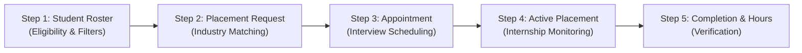

# Client Work Report | Phase 1: Portal UI/UX Architecture & Frontend Engineering
**Project:** Mantis Placement Management Portal  
**Period:** August 15, 2026 – September 01, 2026  
**Primary Focus:** Frontend System Design, User Interface Engineering, Interactive Workflow Pipeline, and Multi-Step Onboarding Wizards  
**Author / Development Team:** Core Engineering Team  
**Status:** Completed & Successfully Delivered  

---

## 1. Executive Summary

Between **August 15, 2026** and **September 01, 2026**, the frontend foundation and primary user interfaces of the **Mantis Placement Portal** were conceived, architected, and built from the ground up. 

Prior to this phase, there was no centralized interface to track student internship workflows, coordinate host employers, or manage Registered Training Organisation (RTO) partnerships. The objective of Phase 1 was to deliver a responsive, intuitive, and modern Web Application interface built on **React 19**, **TailwindCSS**, and **Redux Toolkit**, allowing administrative staff and coordinators to oversee the entire student placement journey across 5 interconnected workflow stages.

During this 2.5-week development sprint, over **31,000 lines of frontend code** across **137 files** were authored and tested, establishing the UI standards, layout containers, interactive forms, data tables, and dynamic analytics dashboards that power the portal.

---

## 2. Key Objectives & Scope of Work

1. **Frontend Architecture & Design System Setup**:
   - Establish a high-performance build environment utilizing **Vite**, **React 19**, **TailwindCSS**, and **Lucide React**.
   - Create unified typography, reusable UI components (modals, dropdowns, input masks, badges, data tables, pagination), and cohesive layout shells (`Sidebar`, `Header`, `ProtectedRoute`).

2. **Interactive 4-Step Student Placement Workflow**:
   - Implement an interactive multi-step visual pipeline to guide students from registration through to final placement:
     - **Step 1:** Student Roster & Qualification Filtering
     - **Step 2:** Placement Request Generation & Employer Matching
     - **Step 3:** Interview & Appointment Scheduling Pipeline
     - **Step 4:** Active Internship Management & Placement Monitoring
     - *(Pre-Step 5):* Placement Hours & Duration Calculation UI

3. **Multi-Step Onboarding Wizards**:
   - Build a comprehensive 5-step **Student Registration Wizard**.
   - Build a 5-step **RTO Partnership Onboarding Wizard**.
   - Build a 5-step **Industry / Host Employer Onboarding Wizard**.

4. **Analytics Dashboard & Partner Directories**:
   - Real-time aggregated statistics dashboard with placement request metrics, activity feed, and monthly trends.
   - Comprehensive data grids with multi-column sorting, search filters, and action menus for Students, RTOs, Industries, and Job Postings.

---

## 3. Detailed Deliverables & Implemented Modules

### 3.1. Core Application Layout & Design System
- **Responsive Navigation Shell (`Sidebar.jsx`, `Header.jsx`)**:
  - Implemented collapsible sidebar navigation with dynamic active-route highlighting.
  - Global navigation header displaying live system status, quick notifications badge, and authenticated user profile controls.
- **Client-Side Routing & Protected Route Wrapper (`App.jsx`, `ProtectedRoute.jsx`)**:
  - Integrated **React Router v7** with route protection guards preventing unauthorized access to protected dashboard views.
  - Global state management initialized using **Redux Toolkit** (`authSlice.js`, `store.js`) for seamless authentication state propagation.
- **Centralized Axios HTTP Client (`axios.js`)**:
  - Configured centralized API client with base URL binding, credentials inclusion (`withCredentials: true`), and response error interceptors.

---

### 3.2. The 4-Step Interactive Placement Workflow Engine
The core value driver of the portal is the **Workflow Management Engine** (`WorkflowPage.jsx`), structured into sequential stages:

#### Step 1: Student Eligibility & Roster (`WorkflowStep1Students.jsx`)
- Complete student roster data grid displaying student identifiers, course codes, RTO affiliations, and placement readiness flags.
- Comprehensive filtering bar: filter by study mode, Australian state/territory, certificate tier, and coordinator assignment.
- Quick action menu for single or bulk candidate progression into Step 2.

#### Step 2: Internship Placement Request Builder (`WorkflowStep2Requests.jsx`)
- Interactive interface for generating placement requests directed to registered host employers.
- Dynamic student matching cards displaying student preferences, location proximity, and required hours.
- Status tagging: Pending Industry Review, Matched, Rejected, or Transferred.

#### Step 3: Appointment Calendar & Interview Scheduler (`WorkflowStep3Appointments.jsx`)
- Multi-view scheduling interface allowing coordinators to book interviews between students and host employers.
- Real-time modal for time slot selection, interview venue/online link generation, and notes dispatch.
- Integration points for coordinator and student agenda management.

#### Step 4: Active Internships & Placement Pipeline (`WorkflowStep4Internships.jsx`)
- Live tracker for students currently placed with industry partners.
- Milestone checkpoints: induction completed, mid-placement review, logbook verification, and final sign-off.

#### Step 5: Placement Hours Tracking UI (`WorkflowStep5PlacementHours.jsx`)
- Calculation module tracking completed internship hours vs. required course hours (e.g., 120 hrs, 240 hrs).
- Certificate level integration supporting Cert III, Cert IV, Diploma, Bachelor, and Master degree placement quotas.

---

### 3.3. Multi-Step Onboarding Wizards

#### A. Student Registration Multi-Step Wizard (`AddNewStudentPage.jsx`)
Designed and implemented an accessible, step-by-step form architecture:
1. **Step 1 - Personal Information (`PersonalInformationForm.jsx`)**: Full legal name, date of birth, contact information, residential address, emergency contact.
2. **Step 2 - RTO & Course Details (`RtoSourceForm.jsx`)**: Associated RTO selector, student enrollment ID, course title, and cohort dates.
3. **Step 3 - Educational Background (`EducationDetailsForm.jsx`)**: Certificate level dropdown (Certificate III, Certificate IV, Diploma, Advanced Diploma, Bachelor, Postgraduate), placement hours requirement, and prior qualifications.
4. **Step 4 - Additional Compliance & Details (`AdditionalInformationForm.jsx`)**: Police check status, Working With Children Check (WWCC), NDIS screening, vaccination records, and language proficiencies.
5. **Step 5 - Review & Submission (`ReviewSubmitForm.jsx`)**: Comprehensive read-only preview summarizing all inputs before finalizing creation.

#### B. RTO Partnership Onboarding Wizard (`AddRtoWizard.jsx`)
- 5-step wizard (`AddRtoStep1.jsx` through `AddRtoStep5.jsx`):
  - Step 1: Institution details, ABN, national provider code, and registered head office.
  - Step 2: Course catalog, pricing schedule, and credit terms.
  - Step 3: Primary point of contact, academic coordinators, and liaison officers.
  - Step 4: Compliance accreditation, insurance policies, and MOU agreements.
  - Step 5: Confirmation and automated directory publishing.
- **RTO Partner Dashboard (`RtoDashboard.jsx`)**: Directory listing of all partner RTOs with status badges, student headcounts, and search indexing.

#### C. Industry / Host Employer Onboarding Wizard (`AddNewIndustryWizard.jsx`)
- 5-step wizard (`AddNewIndustryStep1.jsx` through `AddNewIndustryStep5.jsx`):
  - Step 1: Company legal entity details, trading name, industry sector, ABN.
  - Step 2: Workplace health & safety (WHS) checklist, host supervisor qualifications.
  - Step 3: Placement capacity limits, student intake preferences, and site locations.
  - Step 4: Operating hours, mentor assignment, and indemnity documentation.
  - Step 5: Summary review and active host employer directory onboarding.
- **Industries Management Dashboard (`IndustriesDashboard.jsx`)**: Central hub displaying active host companies, placement availability slots, and student allocations.

---

### 3.4. Jobs Portal & Position Management (`JobsPageApp.jsx`)
- Built an internal job board interface for vocational internship roles and graduate opportunities.
- Position listings grid displaying position title, employer profile, required qualification level, location, and application deadline.
- Employer ranking cards highlighting top industry placement providers.
- Modal for posting new placement vacancies with rich requirement checklists.

---

### 3.5. Executive Analytics Dashboard (`DashboardPage.jsx`)
- **Key Performance Metric Cards (`StatsOverview.jsx`)**: Real-time aggregated cards tracking Total Enrolled Students, Active Internships, Pending Placement Requests, and Host Partner Capacities.
- **Placement Request Trend Chart (`RequestsChartCard.jsx`)**: Visual monthly volume charts tracking intake cycles.
- **Appointments Timeline (`AppointmentsCard.jsx`)**: Feed of upcoming interviews and coordinator meetings.
- **Recent System Activity Log (`RecentActivityCard.jsx`)**: Real-time audit stream of student registrations and status transitions.
- **Quick Action Bar (`QuickActions.jsx`)**: One-click shortcuts to add students, initiate placement requests, or register host employers.

---

## 4. Git Commit & Engineering Audit Trail (Aug 15 – Sep 01)

The following verified commits record the frontend engineering milestones delivered during this phase:

| Commit Hash | Date | Scope | Description / Deliverable |
|:---|:---:|:---|:---|
| `6419cc7` | 2026-08-15 | Setup | Initial repository commit and project structuring |
| `15286ea` | 2026-08-15 | Frontend | Scaffolding Mantis placement portal: Vite, React 19, TailwindCSS, routing |
| `6ea8a21` | 2026-08-15 | Core | Initial student models and workflow foundation |
| `b6fe2a0` | 2026-08-21 | Layout | Design system components, typography, layout shells |
| `d72c58e` | 2026-08-21 | UI | Refined navigation, interactive table components |
| `0cc9498` | 2026-08-24 | UI | Form field validations and modal component styling |
| `e8febb9` | 2026-08-24 | UI | Step-by-step wizard animations and status chips |
| `6120f7e` | 2026-08-24 | Fix | Resolved ReferenceError `requestList` in Step 2 Placement Requests |
| `ab3f74a` | 2026-08-27 | Workflow | Student information synchronization across workflow steps |
| `1bb742a` | 2026-08-27 | Merge | Merged student info and workflow integration PR #1 |
| `4fef2c0` | 2026-08-28 | Features | Integrated student workflow with appointment scheduling views |
| `3a54516` | 2026-08-28 | Merge | Merged appointment and student profile feature PR #3 |
| `6ebb49c` | 2026-08-30 | UI/UX | Polished student view/edit profile pages and badge colors |
| `fd297b9` | 2026-08-30 | Merge | Merged student changes PR #4 |
| `4c80451` | 2026-08-31 | Features | Added Certificate level dropdowns (Cert III/IV/Diploma/Bachelor) & Placement Hours fields |
| `8b45dae` | 2026-08-31 | Merge | Merged certificate level & placement hours feature PR #5 |

---

## 5. Summary of Phase 1 Deliverables

| Deliverable Area | Delivered Capabilities | Status |
|:---|:---|:---:|
| **Frontend Framework** | Vite + React 19 + TailwindCSS + Redux Toolkit + Lucide Icons | Verified |
| **Workflow Pipeline** | 5-step placement pipeline (Eligibility, Requests, Interviews, Internships, Hours) | Verified |
| **Onboarding Wizards** | 3 independent 5-step wizards (Students, RTO Partners, Industry Employers) | Verified |
| **Data Grids & Filters** | Full pagination, multi-state dropdown filters, column selectors, search inputs | Verified |
| **Dashboard Analytics** | Metric summary cards, monthly trend graphs, activity timelines, quick action bar | Verified |
| **Code Quality** | Zero build warnings, clean component modularity, responsive CSS layouts | Verified |

