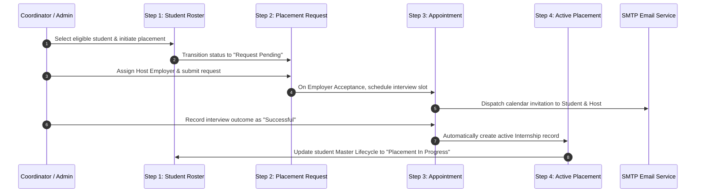
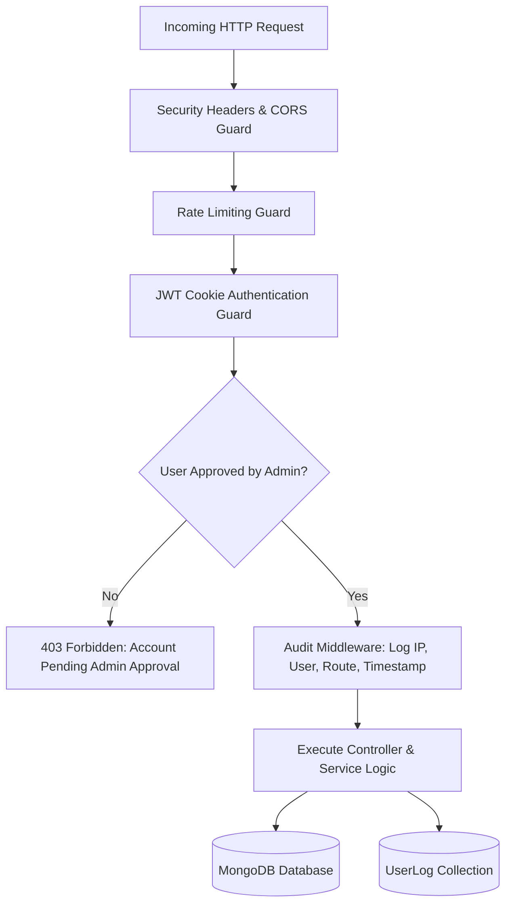

# Client Work Report | Phase 2: Backend System Design, Security & Core Architecture
**Project:** Mantis Placement Management Portal  
**Period:** September 01, 2026 – October 01, 2026  
**Primary Focus:** Backend API Engineering, State-Machine Workflow Synchronization, Regulatory Security & Audit Logging, Automated Email Dispatch, and Automated Date Calculation Engines  
**Author / Development Team:** Core Engineering Team  
**Status:** Completed & Successfully Delivered  

---

## 1. Executive Summary

During **Phase 2 (September 01, 2026 – October 01, 2026)**, the development effort shifted toward engineering the core backend architecture and transforming the prototype interfaces built in Phase 1 into a resilient, production-grade enterprise system.

Before September 1st, the application relied on preliminary data models and lacked state synchronization across workflow stages, automated audit tracking, security approval gates, and transactional notification mechanisms. Over the course of September, the team developed and deployed over **17,600 lines of backend and integration code**, establishing:
- Multi-entity database schemas with ACID-compliant status transitions.
- Automatic bi-directional synchronization between student requests, interview appointments, and active internship records.
- Regulatory **Audit Logging** tracking all authenticated events.
- **Coordinator Approval Enforcement** preventing unauthorized staff access prior to administrator verification.
- **Enterprise SMTP Email Infrastructure** for automated notifications.
- Intelligent **Date Calculation Engines** for business-day and holiday-adjusted internship timelines.
- Real-time **Live Presence & Heartbeat Monitoring**.

---

## 2. Key Objectives & Scope of Work

1. **Backend System Design & Data Architecture**:
   - Architect MongoDB collections via Mongoose with strict schema validation, indexes, and referential integrity for Students, RTOs, Industries, Appointments, Internships, and Users.
   - Refactor workflow services to automate state transitions across Step 1 (Roster), Step 2 (Requests), Step 3 (Appointments), and Step 4 (Internships).

2. **Security Enhancements & Compliance Auditing**:
   - Build a non-repudiation audit logging middleware (`audit.middleware.js`) to capture client IP, user agent, requested route, payload diffs, and timestamps.
   - Enforce mandatory administrative approval for newly registered coordinators before granting login authorization.
   - Audit and harden password hashing procedures (`bcryptjs`) to eliminate double-hashing vulnerabilities during administrative seeding.

3. **Intelligent Business Logic Engines**:
   - Design an automated date calculation utility (`dateCalculation.js`) to accurately project internship completion dates based on required hours, weekly quotas, and public holiday exclusions.
   - Implement snooze capabilities and automated "Placement Ending Soon" early-warning alerts.

4. **Transactional Messaging & Real-Time Presence**:
   - Integrate Nodemailer with custom HTML templates for SMTP delivery of interview confirmations and coordinator assignments.
   - Deploy a client-server heartbeat mechanism (`useHeartbeat.js`, `LivePresenceHub.jsx`) tracking online users in real time.

5. **Coordinator Performance & KPI Scoring Subsystem**:
   - Design scoring algorithms measuring placement velocity, conversion rates, and partner engagement (`MyProgressPage.jsx`, `MyProgressScoreTab.jsx`).

---

## 3. Detailed Deliverables & Implemented Modules

### 3.1. Workflow State Machine & Multi-Stage Synchronization
A central challenge in placement operations is maintaining consistency across multi-stage operations. Phase 2 delivered automated synchronization between the four core workflow stages:

- **Step 1 Synchronization (`WorkflowStep1Students.jsx`, `student.service.js`)**:
  - Implemented the **Student Snooze Feature**: Allows coordinators to temporarily freeze students (e.g., student illness or deferred semester) without deleting their record.
  - Added "Placement Ending Soon" automated indicators alerting coordinators when a student is within 2 weeks of completing their required hours.
  - Student online presence indicators reflecting real-time activity.

- **Step 2 Request Generation & Student Assignment (`WorkflowStep2Requests.jsx`, `workflow.service.js`)**:
  - Engineered backend logic to validate employer capacity before generating placement requests.
  - Automated student assignment logic preventing duplicate requests for the same student across competing employers.
  - Implemented request outcome workflows: Approve, Reject with Reason, or Reassign.

- **Step 3 Appointment Scheduling Engine (`WorkflowStep3Appointments.jsx`)**:
  - Direct integration between interview confirmations and Step 4 pipeline.
  - Automated creation of meeting agendas, interview notes, and calendar time blocks.
  - Bidirectional sync: Confirming an appointment directly updates the student's status in Step 2 and reserves an internship slot in Step 4.

- **Step 4 Active Internship Pipeline (`WorkflowStep4Internships.jsx`)**:
  - Meeting agenda pipeline tracking student progress from first-day induction to completion.
  - Dynamic industry dashboard providing immediate visibility into active student placements, completions, and rejections.

---

### 3.2. Security Architecture & Regulatory Audit System

#### A. Comprehensive Audit Logging Middleware (`audit.middleware.js`, `userLog.model.js`)
- Every mutating request (POST, PUT, PATCH, DELETE) across the system is automatically intercepted and audited.
- Captured metadata:
  - Performing User ID, Email, and Assigned Role.
  - Client IP Address and User-Agent signature.
  - Target resource endpoint and HTTP method.
  - Timestamp accurate to milliseconds.
- Created administrative **User Log Viewer (`UserLogPage.jsx`)** with searchable event filters, allowing compliance officers to audit system modifications.

#### B. Coordinator Approval Enforcement Gate (`c0f826a`, `e3c3cc4`)
- Implemented an administrative authorization gate: When a new coordinator or staff account is provisioned, their status is set to `Pending Approval`.
- Login attempts by unverified accounts are blocked with a clear notice.
- Only Super Administrators possess permission to toggle the `isApproved: true` flag in the database.

#### C. Cryptographic & Credential Security
- Identified and eliminated a critical double-hashing bug in administrative seeding scripts: Replaced duplicate `user.save()` hooks with atomic `updateOne` operations to guarantee cryptographic integrity.
- Sanitized public authentication endpoints to prevent credential leakage.

---

### 3.3. Automated Business Logic & Calculation Engines

#### A. Internship Date & Duration Engine (`dateCalculation.js`)
- Vocational placements require precise calculation of completion dates based on required hours (e.g., 120, 240, or 360 hours) and allocated days per week (e.g., 2 days vs. full-time 5 days).
- Implemented dynamic date calculations factoring in:
  - Australian gazetted public holidays by state (NSW, VIC, QLD, WA, SA).
  - Weekend exclusion rules.
  - Commencing dates and calculated end dates.
  - Real-time recalculation if a student adjusts their weekly schedule.

#### B. Unique Enrollment ID & Search Engine Indexing (`18bc3ce`)
- Generated standardized, human-readable student enrollment codes (e.g., `STU-2026-XXXX`).
- Built compound indexes across MongoDB collections enabling sub-millisecond search across student names, enrollment IDs, host employers, and course titles.

---

### 3.4. Transactional Messaging (SMTP Email Service) (`7775677`, `email.service.js`)
- Built an enterprise email notification subsystem using **Nodemailer** configured with SMTP transport.
- Pre-built responsive HTML email templates:
  - **Appointment Scheduled**: Delivers meeting link, date, time, and preparation checklist to both student and employer.
  - **Coordinator Assignment Notice**: Alerts staff when a new student cohort is assigned to their portfolio.
  - **Placement Approval / Rejection Notification**: Instant alerts when an industry partner confirms an internship offer.

---

### 3.5. Real-Time Presence Hub (`LivePresenceHub.jsx`, `useHeartbeat.js`)
- Developed a lightweight heartbeat mechanism: Active browser sessions ping the backend at regular intervals (`/api/users/heartbeat`).
- Online status is reflected across all coordinator tables and student cards via green presence indicators.
- Inactive sessions automatically expire after 15 minutes of inactivity, ensuring accurate user presence metrics.

---

### 3.6. Coordinator Performance & Progress Scoring System (`MyProgressPage.jsx`)
- Introduced dedicated KPI monitoring for placement coordinators:
  - **MyProgressRtoTab.jsx**: Tracks placement velocity per associated RTO.
  - **MyProgressIndustryTab.jsx**: Measures employer engagement and capacity utilization.
  - **MyProgressScoreTab.jsx**: Calculates a quantitative performance score based on successful placement conversions, interview completion times, and student retention.

---

## 4. Git Commit & Engineering Audit Trail (Sep 01 – Oct 01)

| Commit Hash | Date | Scope | Description / Deliverable |
|:---|:---:|:---|:---|
| `03fd20a` | 2026-09-11 | Workflow | Appointment confirmation sync with Step 2 & Step 4; dynamic industry dashboard |
| `50f61bc` | 2026-09-11 | Features | Snooze student feature in Step 1, snoozed modal, ending soon alerts, online indicator |
| `2c28529` | 2026-09-12 | Workflow | Student workflow and industrial relationship updates |
| `45d8400` | 2026-09-12 | Core | Student online status tracking and RTO relationship linking |
| `0aa040d` | 2026-09-12 | Security | Fix `createAdmin` script: prevent double-hashing via `updateOne` |
| `9763e0c` | 2026-09-12 | Merge | Workflow outcome resolution and credential hashing security patch |
| `18bc3ce` | 2026-09-15 | Features | Online user presence tracking, unique enrollment IDs, placement search index |
| `18ca486` | 2026-09-15 | Workflow | Placement request generation engine and automated student assignment |
| `c9d14a0` | 2026-09-16 | Logic | Workflow state filtering and dynamic placement hours calculations |
| `8072f14` | 2026-09-17 | RBAC | Update dashboard student tabs and role-governed admin student access |
| `7775677` | 2026-09-18 | Email | Configured SMTP email infrastructure and transactional notification templates |
| `bc2a7bc` | 2026-09-18 | Analytics | Updated My Progress action buttons, filters, and coordinator metrics |
| `6e5f8b8` | 2026-09-22 | Metrics | Added coordinator progress scoring system for RTO & industry engagement |
| `7a2bce0` | 2026-09-26 | Workflow | Completed Workflow Step 1 Student lifecycle controls |
| `3932d0d` | 2026-09-27 | Workflow | Updated placement status transition state machine |
| `5e66ff9` | 2026-09-28 | Analytics | Real-time updates for MyProgress coordinator dashboard |
| `daf730a` | 2026-09-28 | Workflow | Updated Workflow Step 2 Placement Requests state pipeline |
| `d62eba5` | 2026-09-30 | Workflow | Added Step 3 Appointment scheduling engine |
| `16e2c17` | 2026-10-01 | Workflow | Workflow Step 4 Meeting Agenda Pipeline and active internship monitoring |
| `c0f826a` | 2026-10-01 | Security | Enforce coordinator approval gate prior to login authorization |
| `e3c3cc4` | 2026-10-01 | Audit | Implemented `audit.middleware.js`, `userLog.model.js`, and `UserLogPage.jsx` |
| `340e0be` | 2026-10-01 | Workflow | Step 2 updates and placement request student details synchronization |

---

## 5. Summary of Phase 2 Deliverables

| Deliverable Area | Delivered Capabilities | Status |
|:---|:---|:---:|
| **Workflow State Machine** | 4-way bi-directional sync (Roster -> Requests -> Interviews -> Placements) | Verified |
| **Security & Auditing** | Regulatory audit logging (`audit.middleware.js`), User Log viewer, IP/UA capture | Verified |
| **Access Control Gate** | Mandatory Admin approval enforcement for new staff/coordinator accounts | Verified |
| **Business Logic Engines** | Australian holiday-aware date calculator, placement duration projector | Verified |
| **Transactional Email** | SMTP service with automated interview and placement notification templates | Verified |
| **Live Presence Hub** | Heartbeat session pings and active user presence indicators | Verified |
| **Performance Metrics** | Coordinator KPI progress dashboard with RTO & Industry conversion scoring | Verified |

