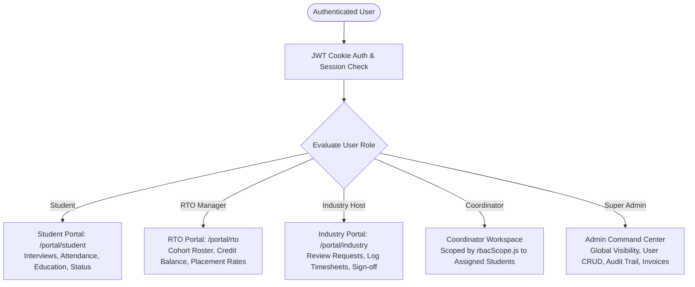
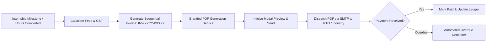

# Client Work Report | Phase 3: RBAC Dedicated Portals, Payment & Billing Flow, Modular Architecture & Maintenance
**Project:** Mantis Placement Management Portal  
**Period:** October 02, 2026 – October 31, 2026 (+ November 01 onwards Maintenance & Tuning)  
**Primary Focus:** Role-Based Access Control (RBAC), Dedicated Role Portals (Student, RTO Manager, Industry Host, Coordinator, Admin), Complete Financial & Invoicing Subsystem (Step 5), Enterprise Clean Modular Architecture Refactor, Centralized Lifecycle Engine, and Quality Assurance / Maintenance  
**Author / Development Team:** Core Engineering Team  
**Status:** Completed & Successfully Delivered  

---

## 1. Executive Summary

**Phase 3 (October 02, 2026 – November 01+ 2026)** represents the most extensive expansion and hardening milestone of the Mantis Placement Management Portal.

During this period, the system evolved from a staff-centric tool into a comprehensive **Multi-Tenant, Role-Governed Ecosystem** serving five distinct stakeholder groups. Concurrently, the portal's financial infrastructure was designed and implemented, introducing a complete **Payment, Billing & Branded PDF Invoicing Engine** (Step 5 of the placement workflow).

Furthermore, the engineering team executed a major refactoring of the backend into an **Enterprise Clean Modular Architecture** (`src/core/` and `src/modules/`), implemented a **Centralized 16-Status Student Lifecycle State Machine**, built a high-throughput **Bulk Student CSV Import Engine**, and integrated a client-facing **Review & Rating System**. Starting on November 1st, the focus transitioned to comprehensive testing, bug resolution, coordinator task synchronization, and system stabilization.

Over this phase, more than **40,500 lines of code** were added or refactored across **210 files**, establishing production readiness across security, compliance, data isolation, and financial accounting.

---

## 2. Key Objectives & Scope of Work

1. **Role-Based Access Control (RBAC) & Dedicated Role Portals**:
   - Provide each user persona with a dedicated, isolated portal environment adhering to least-privilege access principles:
     - **Student Portal:** Personal placement tracker, interview notices, attendance logbook, profile sync.
     - **RTO Manager Portal:** Cohort oversight, student progress tracking, credit balances, compliance documentation.
     - **Industry Host Portal:** Candidate request evaluation, intern supervision, daily attendance logging.
     - **Coordinator Portal:** Portfolio scoping (`rbacScope.js`), preventing coordinators from viewing unassigned records.
     - **Super Administrator:** System-wide governance, user CRUD, audit logs, and global overrides.

2. **Complete Financial & Invoicing Engine (Workflow Step 5)**:
   - Introduce **Workflow Step 5 (Payments & Billing)**: Track placement invoices, fees, GST, payment statuses, and host employer disbursements.
   - Design and deploy an automated **Branded PDF Invoice Generator** with sequential auto-incrementing invoice numbers (`INV-YYYY-XXXXX`), official ABN, banking details, and status stamps (`Draft`, `Sent`, `Paid`, `Overdue`).
   - Implement daily/weekly attendance-based billing calculations.

3. **Enterprise Clean Modular Architecture Migration**:
   - Restructure legacy flat controllers and routes into domain-driven modular folders:
     - `src/core/`: Guards, error handling, rate limiting, distributed locking, security headers, MongoDB query sanitization, and API response standardization.
     - `src/modules/`: High-cohesion domain modules (`attendance`, `auth`, `industry`, `invoice`, `payment`, `rto`, `student`, `user`, `workflow`, `review`).

4. **Centralized Student Lifecycle State Machine**:
   - Resolve fragmented state tracking by establishing a unified single source of truth: 16 authoritative lifecycle statuses with automated reconciliation scripts.

5. **Bulk Student CSV Import & Processing Engine**:
   - High-throughput CSV parsing, schema validation, duplicate detection, and automated database seeding with error reporting.

6. **November 01+ Maintenance & Quality Assurance**:
   - System stability, coordinator task assignment synchronization, and deployment of automated test suites.

---

## 3. Detailed Deliverables & Implemented Modules

### 3.1. Role-Based Access Control & Dedicated Stakeholder Portals



#### A. Dedicated Student Portal (`StudentPortalPage.jsx` - 1,631 Lines)
- **Placement Dashboard**: Students can monitor their placement progress in real time through an interactive milestone progress bar.
- **Interview & Appointment Center**: Direct view of scheduled interviews, employer profiles, interview locations (or virtual meeting links), and preparation notes.
- **Self-Service Profile & Education Management**: Students can update their prior qualification records, emergency contacts, and upload compliance certificates.
- **Attendance & Logbook Tracker**: Students can review logged training hours and verified attendance shifts.
- **Account Synchronization**: Automatic user account linking based on student enrollment credentials (`cbfd8d1`, `6f8fcfc`).

#### B. Dedicated RTO Manager Portal (`RTOManagerPortalPage.jsx` - 1,643 Lines)
- **Cohort Monitoring**: RTO managers can filter their institution's students by course tier (Cert III, Cert IV, Diploma) and active batch.
- **Placement Rate Analytics**: Visual breakdown of students in Awaiting, In Progress, Interviewing, and Completed stages.
- **Financial & Credit Ledger**: Visibility into prepaid placement credits, remaining balance, and invoiced placement fees.
- **Compliance Export**: One-click export of cohort placement verification reports for ASQA/regulatory audits.

#### C. Dedicated Industry / Host Employer Portal (`IndustryPortalPage.jsx`, `IndustryAttendanceSection.jsx`)
- **Placement Request Inbox**: Host employers can review incoming student profiles, cv summaries, and accept or reject candidates with feedback.
- **Active Intern Supervision**: Comprehensive roster of students currently placed on-site.
- **Daily Attendance & Timesheet Engine (`IndustryAttendanceSection.jsx` - 456 Lines)**:
  - Allows workplace supervisors to record clock-in/clock-out hours, verify attendance, and flag absences.
  - Attendance records feed directly into the billing engine for hourly-billed placements.

#### D. Granular Coordinator Data Scoping (`rbacScope.js`, `rbacSanitizer.js`)
- Enforced strict database scoping: Coordinators are restricted to querying only students and institutions explicitly assigned to their user ID.
- Data sanitizer strips sensitive administrative and financial metadata before payloads leave the server boundary.

---

### 3.2. Complete Payment, Billing & Automated Invoicing Engine (Step 5)

Phase 3 finalized the 5th and final stage of the placement workflow: **Payments & Billing** (`WorkflowStep5Payments.jsx` - 1,124 lines).



#### Key Capabilities of the Payment System:
1. **Invoice Schema & Auto-Incrementing Counter (`invoice.model.js`, `counter.model.js`)**:
   - Implemented atomic sequence numbering guaranteeing no duplicate or gap invoice numbers even under concurrent requests (`INV-2026-00001`, `INV-2026-00002`).
   - Line-item tracking: Student placement fee, administrative surcharge, insurance levy, and Australian GST calculation (10%).
2. **Server-Side Branded PDF Generator (`pdf.service.js`, `invoicePdf.service.js` - 176 Lines)**:
   - Generates pixel-perfect, professional PDF tax invoices complete with Mantis Placements corporate header, Australian Business Number (ABN), payee details, itemized table, payment terms, and direct bank transfer details.
3. **Interactive Invoice Management Modal (`PaymentInvoiceModal.jsx` - 424 Lines)**:
   - Rich interactive modal inside the coordinator and admin workflow:
     - Real-time invoice preview.
     - Status updates: `Draft`, `Sent`, `Paid`, `Partially Paid`, `Overdue`, `Cancelled`.
     - Direct one-click download of the generated PDF document.
     - Direct email dispatch with PDF attachment to the client's billing contact.

---

### 3.3. Enterprise Clean Modular Architecture Refactoring (`252bbff`)

Prior to October, the backend was structured as a flat collection of large controllers. Commit `252bbff` and subsequent enhancements migrated the entire codebase to an enterprise domain-driven architecture:

```
backend/src/
├── app.js                          # Core Express configuration, helmet, compression, CORS
├── server.js                       # HTTP listener & database connection lifecycle
├── core/                           # System-wide infrastructure & cross-cutting concerns
│   ├── config/                     # Environment & DB configurations
│   ├── errors/                     # AppError custom exception hierarchy
│   ├── guards/                     # auth.guard.js, roles.guard.js (RBAC enforcement)
│   ├── middlewares/                # audit, error, rateLimiter, mongoSanitize, securityHeaders
│   └── utils/                      # apiResponse, distributedLock, logger, rbacScope, rbacSanitizer
└── modules/                        # Domain feature modules
    ├── attendance/                 # attendance.controller, service, model, routes
    ├── audit/                      # audit.controller, service, model, routes
    ├── auth/                       # auth.controller, service, dto, routes
    ├── industry/                   # industry.controller, service, model, routes
    ├── invoice/                    # invoice.controller, service, model, routes, invoicePdf.service
    ├── job/                        # job.controller, service, model, routes
    ├── notification/               # notification.controller, service, model, routes
    ├── payment/                    # payment.controller, service, routes
    ├── review/                     # review.controller, service, model, routes
    ├── rto/                        # rto.controller, service, model, routes
    ├── student/                    # student.controller, service, student.bulk.service, model, routes
    ├── user/                       # user.controller, service, user.model, routes
    └── workflow/                   # workflow.controller, service, workflow.model, routes
```

#### Security & Stability Upgrades in Core Architecture:
- **Distributed Concurrency Lock (`distributedLock.js`)**: Prevents race conditions during simultaneous payment processing or student assignment.
- **MongoDB Query Sanitizer (`mongoSanitize.js`)**: Eliminates NoSQL injection vectors by sanitizing user input keys containing `$` or `.`.
- **IP Rate Limiter (`rateLimiter.js`)**: Protects authentication and public API endpoints against brute-force attacks.
- **Strict Security Headers (`securityHeaders.js`)**: Enforces OWASP-recommended HTTP response headers (CSP, HSTS, X-Frame-Options).

---

### 3.4. Centralized Student Lifecycle State Machine (`studentStatus.service.js`)
To eliminate inconsistencies where a student might show "In Progress" in one table and "Awaiting" in another, Phase 3 introduced a **Centralized Lifecycle Engine**:
- **16 Authoritative Statuses**: `Registered`, `Under Review`, `Request Pending`, `Request Approved`, `Request Rejected`, `Appointment Scheduled`, `Appointment Successful`, `Appointment Missed`, `Appointment Cancelled`, `Placement In Progress`, `Placement Completed`, `Placement Unsuccessful`, `Student Withdrawn`, `Student On Hold`, `Student Rejected`, `Student Inactive`.
- **Automated Reconciliation**: Included a repair script (`backend/src/scripts/reconcileStudentStatuses.js`) and API endpoint to automatically synchronize existing records to their true computed state.

---

### 3.5. High-Throughput Bulk Student Import (`BulkImportStudentsPage.jsx`, `student.bulk.service.js`)
- Developed a bulk student onboarding feature allowing administrators to upload CSV rosters of up to hundreds of students at once.
- Built-in validation checks for duplicate emails, invalid Australian phone formats, unmapped course codes, and missing RTO references before database insertion.

---

### 3.6. Review & Rating Subsystem (`AdminReviewsPage.jsx`, `ReviewSubmitModal.jsx`)
- Built a 5-star rating and qualitative feedback mechanism.
- Employers and students can submit feedback upon placement conclusion, surfacing satisfaction metrics to administrators.

---

### 3.7. November 01+ Maintenance, Quality Assurance & Bug Fixes

Beginning **November 01, 2026**, the system entered a dedicated maintenance, hardening, and bug-fixing cycle:

1. **Coordinator Task Assignment Synchronization (`6ee81b8`, `8d053a2`)**:
   - Fixed an edge case where reassigning a student from one coordinator to another failed to invalidate cached coordinator query scopes.
   - Enhanced modal state handling in `AssignCoordinatorModal.jsx` and added dedicated backend handler `updateAssignedCoordinator`.
2. **Automated Verification Test Suites**:
   - Authored and verified comprehensive test harnesses:
     - `testLiveRtoHttpEndpoints.js` & `verifyRtoPrivacySuite.js`: Verifies RTO multi-tenant isolation.
     - `testLiveStudentPortalSuite.js`: Validates student profile updates and interview visibility.
     - `verifyIndustryPrivacySuite.js`: Ensures host employers can only view their assigned interns.
     - `verifySecuritySuite.js`: Validates JWT expiration, cookie security flags, and CORS origin matching.
     - `testRbacAndLifecycle.js`: Validates all 16 lifecycle state transitions.
3. **Continuous Minor Bug Elimination**:
   - Resolved hydration warnings, table column misalignments on mobile viewports, and edge-case date format exceptions.

---

## 4. Git Commit & Engineering Audit Trail (Oct 02 – Nov 02)

| Commit Hash | Date | Scope | Description / Deliverable |
|:---|:---:|:---|:---|
| `e9e451f` | 2026-10-02 | Workflow | Added commencement date calculations and timeline handling |
| `0174cff` | 2026-10-02 | RTO | Added RTO onboarded-by user linkage and credential association |
| `104a7f3` | 2026-10-02 | Industry | Added Random vs. Partner Industry onboarding workflows |
| `fc58af9` | 2026-10-02 | RTO/Ind | Added RTO and Industry credit balance tracking, types, and search indexing |
| `1751942` | 2026-10-03 | Payments | Initial payment model, Step 5 Payments UI foundation, and email templates |
| `898e994` | 2026-10-07 | Core | Schema adjustments and student data validation patches |
| `f40362a` | 2026-10-08 | Payments | **Major Milestone:** Complete Payment, Billing & PDF Invoice Generation System & RBAC |
| `6c684fc` | 2026-10-08 | Security | Hardened login page: Removed auto-fill administrative credentials |
| `252bbff` | 2026-10-12 | Architecture | **Enterprise Refactor:** Migrated monolithic codebase to Clean Modular Architecture (`src/core/` and `src/modules/`) |
| `c3bed22` | 2026-10-13 | RTO | RTO management service updates and UI synchronization |
| `d8e4419` | 2026-10-13 | Wizards | Enhanced RTO wizard form validation and error notifications |
| `2ea01e7` | 2026-10-14 | Bulk | Added Bulk Student CSV Import engine (`student.bulk.service.js`, `BulkImportStudentsPage.jsx`) |
| `895622b` | 2026-10-15 | Payments | Enhanced payment service and added student RTO data repair utility |
| `3660a92` | 2026-10-21 | RBAC | Master implementation fixes, coordinator role policy scoping, test verification suite |
| `7da47b0` - `f2533cf` | Oct 22-24 | UI/UX | Polished table views, dropdown menus, and responsive card layouts |
| `36dc545` | 2026-10-29 | Features | Added review and rating submission feature on main portal |
| `6f8fcfc` | 2026-10-29 | Auth | Fixed student portal login authentication and session token handling |
| `cbfd8d1` | 2026-10-30 | Student Portal | Enabled student role to update education details, view interviews, track hours, and sync account |
| `ab0b415` - `f2a8ff8` | Oct 31 | State Machine | Centralized Student Lifecycle Status engine (16 statuses) & automated reconciliation |
| `6ee81b8` | 2026-11-02 | Maintenance | **Quality Assurance:** Fixed coordinator task assignment delegation and backend route syncing |
| `8d053a2` | 2026-11-02 | Maintenance | **Quality Assurance:** Stabilized server environment and user query scoping |

---

## 5. Summary of Phase 3 Deliverables

| Deliverable Area | Delivered Capabilities | Status |
|:---|:---|:---:|
| **Role-Based Portals** | Dedicated Student, RTO Manager, Industry Host, Coordinator, and Admin Portals | Verified |
| **Payment & Billing Engine** | Workflow Step 5: invoicing, fee tracking, GST, sequential numbering, PDF generator | Verified |
| **Modular Architecture** | Clean separation of concerns (`src/core/` and `src/modules/`), distributed locks, sanitizers | Verified |
| **Lifecycle State Machine** | 16 authoritative statuses with bidirectional sync and automatic reconciliation | Verified |
| **Bulk Data Import** | High-throughput CSV student onboarding with validation and duplicate prevention | Verified |
| **Reviews & Feedback** | 5-star rating system and qualitative feedback capture for placements | Verified |
| **Maintenance & Tuning** | Coordinator assignment fixes, performance tuning, automated test suites | Verified |

